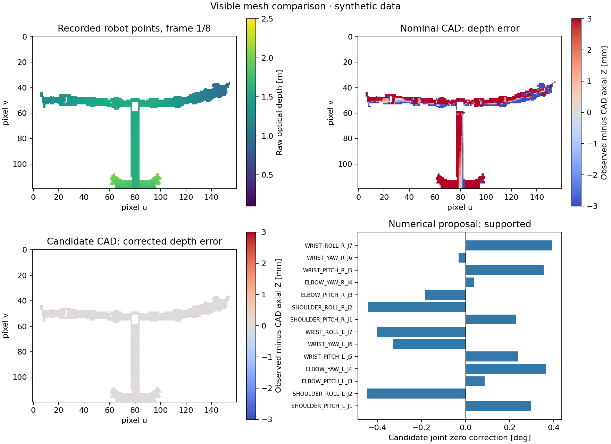

# OmniCalibration

[OmniCalib（arXiv:2609.19582v2）](https://arxiv.org/abs/2609.19582v2) 的独立算法复现，当前重点为 **Marvin 单臂、双臂关节零偏及相机外参标定**。已接入用户提供的真实 URDF 和视觉网格，提供独立三角面观测、带自身遮挡的深度渲染、真实数据 NPZ 接口和分阶段腕部相机标定。

当前为 **算法与合成数据验证**，尚未验证实机精度。资产中没有实际相机挂载；示例相机位置和腕部安装均为假设配置。代码不会修改原始 URDF、编码器或控制器。

**v0.3.0 冻结基准**：80 项自动化测试通过；完成 400 次冻结主评估和 298 次分离补充对照。主评估中 380 个预期可观测案例有 374 个通过接受条件，另外 20 个退化案例按预期保留；未接受记录完整保留。详见 [主验证](docs/VALIDATION.md)、[补充验证](docs/SUPPLEMENTARY.md)。

当前源码 **v0.3.2** 增加续算预算与异常回退，85 项测试通过，64 次独立合成验证完成；平方噪声压力场景最坏误差为 0.201°，超过 0.1° 参考线。见 [预算与验证报告](docs/BUDGET_v032.md)。

前次版本 **v0.3.1** 增加末次估计续算，82 项测试通过；两个历史未收敛案例恢复稳定，另有 28 次独立验证。开关、预算和局限见 [续算验证](docs/CONTINUATION_v031.md)。上述 v0.3.0 数据保留为独立基准。

## 安装与快速验证

测试环境为 Linux x86_64、Python 3.10，CPU 即可，未使用 GPU。

```bash
uv venv .venv --python python3.10
uv pip install --python .venv/bin/python -r requirements-lock.txt -e .
bash scripts/reproduce.sh
```

当前环境已创建 `.venv`。完整依赖固定在 `requirements-lock.txt`；无 uv 时可用 `python3.10 -m venv .venv` 后通过 pip 安装。

默认资产路径为 `../HumanoidAssets/Marvin_M6_S_CCS_696_V4.0`。资产位于其他位置时，标定和演示命令附加 `--asset-root /path/to/Marvin_M6_S_CCS_696_V4.0`。

## 单臂、双臂深度标定

以下示例估计选定机械臂的零偏和固定 RGB-D 相机的 6 个外参修正。使用真实三角面、视场裁剪、自身遮挡和 0.2 mm 轴向深度噪声。固定基座表面为参考系提供锚定；这里的相机是放置在机器人前方的假设观察相机。

```bash
# 左臂：7 个零偏 + 6 个相机参数，同时导出可回放的观测
.venv/bin/python -m omnicalib asset-demo \
  --config configs/marvin_left.json --matching triangle --render-depth \
  --profile robust --frames 8 --iterations 30 --noise-m 0.0002 \
  --camera-position 1.6 0 1.1 --camera-target 0 0 1.0 \
  --save-dataset outputs/left.npz --output outputs/left.json

# 双臂：14 个零偏 + 6 个相机参数
.venv/bin/python -m omnicalib asset-demo \
  --config configs/marvin_dual.json --matching triangle --render-depth \
  --profile robust --frames 8 --iterations 30 --noise-m 0.0002 \
  --camera-position 1.6 0 1.1 --camera-target 0 0 1.0 \
  --output outputs/dual.json

# 右臂使用 configs/marvin_right.json
```

`--profile robust` 使用延后裁剪、0.5 倍局部更新和基于局部不确定度的停止准则。相机初值、邻近初值重试、残差一致性检查均记录在 JSON 中，未使用注入真值挑选解。固定按迭代次数强行收紧距离曾在新种子上失败，已从推荐配置中移除；失败记录仍保留。

## 更接近机载视角的伸手动作

逆运动学生成双手伸到机身前方的姿态，近机身假设相机观察机器人自身：

```bash
.venv/bin/python -m omnicalib asset-demo \
  --config configs/marvin_dual.json --matching triangle --render-depth \
  --posture-mode reaching --profile robust --frames 8 --iterations 30 \
  --noise-m 0.0002 --camera-position 0.18 0 1.23 --camera-target 0.45 0 0.85 \
  --output outputs/onboard_reaching.json
```

IK 只验证关节限位和末端目标，不验证碰撞、速度、力矩或硬件执行可行性。渲染只包含配置中列出的观测网格，不含环境、光学畸变、多路径等完整传感器效应。

## 独立单臂与规范自由度

仅观察单臂运动表面，同时估计相机位姿时，第一关节零偏会与相机位姿耦合。增加姿态数量不能自动消除此自由度。可观察固定几何参考，或提供已知相机外参：

```bash
# 独立 left_arm.urdf；相机已知，仅估计 7 个零偏
.venv/bin/python -m omnicalib asset-demo \
  --config configs/marvin_standalone_left.json --fixed-camera \
  --matching triangle --independent-sampling \
  --output outputs/standalone.json

# 退化对照：完整模型中仅观测左臂，去掉固定基座参考
.venv/bin/python -m omnicalib asset-demo \
  --config configs/marvin_left.json --matching triangle --render-depth \
  --no-anchor --output outputs/unanchored.json
```

退化对照应给出 `rank=12/13` 并保留名义修正。`success` 表示内部求解器成功；是否接受整组修正还取决于 `icp_converged`、`quality_passed`、参数界限、秩、条件数和用户指定的 sigma 阈值。最终决定见 `proposal.block_supported` 和 `proposal.block_reasons`。

## 数据回放与真实数据接口

```bash
.venv/bin/python -m omnicalib calibrate \
  --config configs/marvin_left.json --input outputs/left.npz \
  --matching triangle --profile robust --iterations 30 \
  --output outputs/left_replayed.json
```

NPZ 格式包含关节名称、同步读数、已分割的相机坐标点云和名义外参，支持每帧不同数量的点及未标定关节的运动。可选合成真值单独保存；标定入口不会读取它。真实数据转换示例见 [数据格式](docs/DATA_FORMAT.md)。

编码器噪声会同时影响同一帧的许多点。已知其标准差时，可使用共享误差模型，例如：

```bash
.venv/bin/python -m omnicalib calibrate \
  --config configs/marvin_dual.json --input your_dataset.npz \
  --profile robust --loss linear --residual-sigma-m 0.0002 \
  --assumed-encoder-sigma-deg 0.01 --max-joint-sigma-deg 0.1 \
  --iterations 30 --output outputs/calibration.json
```

这些数值是示例噪声假设，不是 Marvin 硬件规格。`--encoder-noise-deg` 用于合成注入；`--assumed-encoder-sigma-deg` 才是估计器使用的噪声假设，两者独立。

## 冻结机械臂修正后标定腕部相机

```bash
.venv/bin/python -m omnicalib staged-demo \
  --config configs/marvin_dual.json --moving-root \
  --output outputs/staged_dual.json
```

先用深度估计机械臂零偏，再冻结该结果，通过同步的**米制相机位姿**和机器人 FK 估计腕部外参；已知根部运动会先投影到腕部挂载。这里的腕部位姿是合成测量，尚未实现真实互视、RGB-D VO 或图像前端。

## 统计验证和图像

```bash
# 完整多种子评估；逐案例保存检查点、代码快照、输入哈希，可续跑；基准脚本的资产路径由对应配置指定
.venv/bin/python scripts/benchmark.py \
  --plan configs/benchmark_final.json --output outputs/heldout --resume

# 导出可分享的 PNG 和 SVG 图
.venv/bin/python scripts/plot_benchmark.py outputs/heldout
.venv/bin/python scripts/preview_depth.py --random-posture
```

报告输出到 `outputs/`。详见 [方法与论文差异](docs/REPRODUCTION.md)、[验证记录](docs/VALIDATION.md) 、[实验入口与证据索引](docs/EXPERIMENTS.md) 和 [首轮优化记录](docs/OPTIMIZATION_LOG.md)。

测试与静态检查：

```bash
PYTEST_DISABLE_PLUGIN_AUTOLOAD=1 .venv/bin/python -m pytest -q
.venv/bin/ruff check omnicalib scripts tests
```

禁用 pytest 自动插件加载，是为了避免当前 shell 暴露的 ROS `launch_testing` 插件版本冲突。没有 Marvin 资产时，资产集成测试跳过。下肢和头部仅保留论文残差的独立数值示例，尚未与 Marvin 集成。

## 深度尺度与可视化对照

可选地联合估计深度乘数，适用于具有可信米制几何参考的观测。下面注入 0.5% 深度尺度偏差；优化器不读取该真值，所用噪声假设需要单独声明。

```bash
.venv/bin/python -m omnicalib asset-demo \
  --config configs/marvin_dual.json --matching triangle --render-depth \
  --frames 8 --iterations 35 --noise-m 0.0002 --residual-sigma-m 0.0002 \
  --depth-scale-bias 0.005 --estimate-depth-scale --step-relaxation 0.5 \
  --profile robust --camera-position 1.6 0 1.1 --camera-target 0 0 1.0 \
  --save-dataset outputs/scale.npz --output outputs/scale.json

.venv/bin/python -m omnicalib calibrate \
  --config configs/marvin_dual.json --input outputs/scale.npz \
  --estimate-depth-scale --residual-sigma-m 0.0002 --iterations 35 \
  --profile robust --step-relaxation 0.5 --output outputs/scale_replayed.json

.venv/bin/python scripts/preview_calibration.py \
  --config configs/marvin_dual.json --input outputs/scale.npz \
  --report outputs/scale_replayed.json --animate --output outputs/scale_preview.png
```

返回 `depth_scale` 满足 `p_corrected = depth_scale * p_raw`。全局 CAD 尺寸与深度尺度可能不可区分；此选项不代替独立米制参考。尺度参数也参与整组可观测性和不确定度判断。光轴噪声模型、参数协方差和每帧/连杆残差见 [数据格式](docs/DATA_FORMAT.md)。



[八帧动画](docs/figures/scale_calibration.gif)；图中轴向误差包含轮廓和遮挡变化，不是 ICP 点面残差或实机精度。第二轮实验与失败记录见 [持续优化记录](docs/ROUND2_LOG.md)。

## 从已有观测中减少拟合帧数

```bash
.venv/bin/python scripts/select_frames.py \
  --config configs/marvin_dual.json --input your_dataset.npz \
  --count 6 --strategy information --output outputs/selected.npz

.venv/bin/python -m omnicalib calibrate \
  --config configs/marvin_dual.json --input outputs/selected.npz \
  --profile robust --iterations 35 --output outputs/selected_calibration.json
```

选择器使用名义几何雅可比，按增量 log-det 排序，仅读取同步关节和表面点；导出的子集不复制合成真值。排序正则项不参与最终标定和秩诊断。该启发式使用各向同性独立点噪声评分，不能保证最小真实误差，也不生成可直接执行的机器人动作。已知相机或同时估计尺度时，选择与标定两步应使用一致的 `--fixed-camera`、`--estimate-depth-scale` 参数。

独立右臂使用 `configs/marvin_standalone_right.json --fixed-camera`。左右独立模块分别以 `left_arm_base`、`right_arm_base` 为根；整机配置以 `base_link` 为根。若只标定左臂但输入包含整机点云，可使用 `configs/marvin_left_full_scene.json` 并逐帧提供已可信的右臂状态；具体参考条件见 [数据接口](docs/DATA_FORMAT.md#单臂标定时的整机点云)。

当前 Marvin 两个肩部第一关节轴线共线：去掉固定机身参考后，**双臂也有一个公共肩部/相机歧义，秩为 19/20**。更多姿态不能消除该自由度。默认三种整机配置均包含固定参考；原理与 30 次退化对照见 [方法说明](docs/REPRODUCTION.md#marvin-双臂也存在公共规范自由度) 和 [补充验证](docs/SUPPLEMENTARY.md)。
