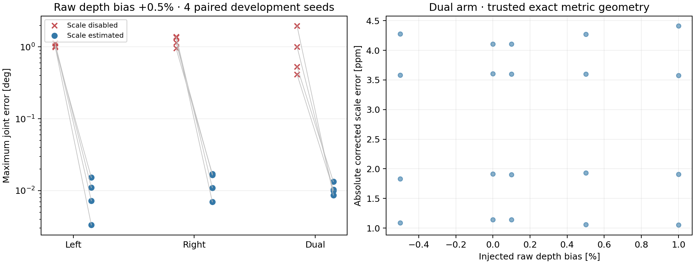
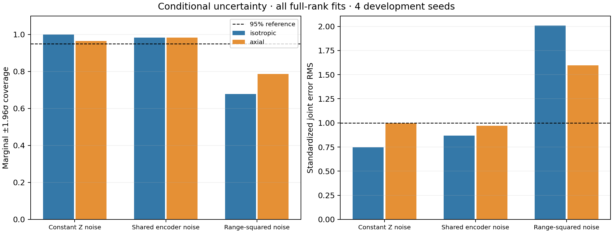

# 实验入口与证据索引

所有实验均为合成数据。估计器不读取评分真值；源码快照和逐案例记录在 `outputs/`，紧凑统计与图在 `docs/`。主评估与开发调参分开保存，不把开发种子补入新种子统计。

| 目的 | 计划 | 规模 | 结果目录（相对仓库） |
|---|---|---:|---|
| v0.2.3 历史评估 | `configs/benchmark_final_v023.json` | 220 | `outputs/final_v023` |
| v0.3.0 冻结新种子评估 | `configs/benchmark_final.json` | 400 | `outputs/final_v030` |
| 编码器缩步开发对照 | `configs/benchmark_round2_convergence.json` | 12 | `outputs/round2/convergence_ablation` |
| 深度尺度开发对照 | `configs/benchmark_round2_scale_development.json` | 40 | `outputs/round2/scale_development` |
| 光轴噪声开发对照 | `configs/benchmark_round2_noise_v2.json` | 24 | `outputs/round2/noise_development_v2` |
| 距离平方噪声参数开发 | `configs/benchmark_round2_quadratic_followup.json` | 24 | `outputs/round2/quadratic_development` |
| 距离平方噪声独立后续验证 | `configs/benchmark_round2_quadratic_holdout.json` | 60 | `outputs/round2/quadratic_holdout_complete` |
| 成对帧数预算对照 | `configs/benchmark_round2_selection.json` | 120 | `outputs/round2/selection_complete` |
| 点数预算与共享编码器协方差 | `configs/benchmark_round2_point_budget.json` | 48 | `outputs/round2/point_budget_complete` |
| 单/双臂无参考退化 | `configs/benchmark_round2_gauges.json` | 30 | `outputs/round2/gauges_complete` |
| 独立右臂、已知/未知相机 | `configs/benchmark_round2_standalone_right.json` | 40 | `outputs/round2/right_standalone_complete` |
| 较大相机初值压力开发 | `configs/benchmark_round2_initialization.json` | 12 条记录 | `outputs/round2/initialization_development` |

表中的规模表示计划的唯一 `(场景, seed)` 数，含不接受结果和异常。大初值开发有 10 次返回估计、2 次在单例运行超过 20 分钟后停止；停止记录不是成功完成的估计。两个 30mm/3° 案例随后使用冻结 v0.3.0 单独重放，见 `outputs/round2/initial_v030_30mm`，不能将其替换到旧版开发统计中。

## 运行与审计

```bash
# 从仓库根目录运行。资产路径改变时可加 --asset-root。
.venv/bin/python scripts/benchmark.py \
  --plan configs/benchmark_final.json --output outputs/recheck_v030 --resume

# 多进程可将同一计划的种子拆到不同输出目录，之后合并。
.venv/bin/python scripts/merge_benchmarks.py outputs/batch1 outputs/batch2 \
  --output outputs/merged --require-complete

.venv/bin/python scripts/audit_results.py outputs/merged
.venv/bin/python scripts/plot_benchmark.py outputs/merged
```

`--resume` 用于相同源码、计划、种子批次、环境和输入的中断续跑。它保留已有失败记录；更改这些条件时使用新输出目录。续跑前检查配置与 URDF 哈希，并核对已有成功记录引用的网格；不先覆写旧 manifest。更改资产路径也使用独立批次。审计旧记录时可加 `audit_results.py --asset-root /relocated/Marvin`，按原始相对路径核对外部资产哈希。

合并器拒绝不同数值源码、计划、配置或 URDF。审计器核对严格 JSON、唯一键、冻结源码与配置、引用的资产、参数布局、物理单位协方差、残差汇总、终止状态与整组接受条件。审计通过表示记录内部一致，不证明实机精度。

## 统计解释

- 误差统计包含返回的全部估计，不仅统计通过接受门的估计。
- 退化场景不画成精度样本；任意规范解与真值之差没有唯一含义。
- 边际 ±1.96σ 覆盖率只作条件协方差诊断。关节相关、对应点选择和模型误差都限制其解释。
- 帧数对照在每个种子生成同一批 12 帧，再比较 first/random/information 选择的 4 或 6 帧。选帧不是动作规划，也不保证真实误差最小。
- 点数对照使用 320×240 渲染、500/2000/8000 点上限；实际可见点可能少于上限。不同点数配置共享相同的帧级编码器扰动，不能把增加像素数当作增加独立编码器测量。
- 后续距离平方噪声验证使用新的 13001–13020 种子，候选权重下限在原四个开发种子上确定。原 400 次评估保持不变。





成对开发统计见 [JSON](results/round2_development.json)。最终完整统计与失败记录见 [验证记录](VALIDATION.md)；方法与缺失的论文前端见 [复现边界](REPRODUCTION.md)。
