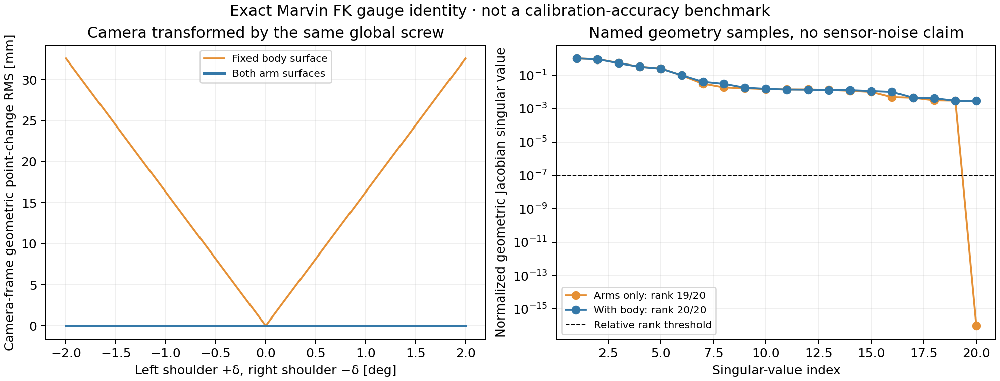

# 方法、论文映射与复现边界

依据为用户提供的 `/home/ubuntu/Documents/2609.19582v2.pdf`，并核对了 [arXiv v2 页面](https://arxiv.org/abs/2609.19582v2)。这是独立实现，不是作者源码移植。当前没有 A3 Ultra 模型、作者 ROS bags、完整参数配置或实机参考解；本次检索未找到可直接使用的作者实现链接，但不能据此断言作者从未公开代码。

用户指定先做算法与合成验证，随后提供 Marvin 资产，并要求面向单臂、双臂。因此主要实现论文 III-C 的上肢几何标定与分阶段腕部外参，III-D/III-E 仅保留独立数值核心。

## 参数、坐标与噪声

`T_AB` 将 B 中坐标变换到 A。内部使用米和弧度；关节零偏满足 `q_corrected = q_measured + delta_q`。

相机外参右乘修正：

```text
T_BC_corrected = T_BC_nominal @ Exp([v, w])
```

使用真正的 SE(3) 指数映射，其平移为 `J_left(w) @ v`。报告中 `camera_tx/ty/tz` 是 Lie 坐标 v 的分量，不能在大角度下直接解释成根坐标系平移增量。头部旋转则按论文左乘公共修正。

`Robot.select` 指定任意长度的独立角关节列表。零偏优化目前只支持 revolute/continuous；prismatic 和 mimic 在 FK 中受支持，但不作为上肢角零偏重复估计。未标定关节可逐帧提供已知状态。

`--noise-m` 是合成观测的实际噪声；`--residual-sigma-m` 是优化器假定的残差尺度。默认后者为 1 mm，通常比演示中的 0.2 mm 深度噪声保守，二者不会自动混同。

## 上肢式 (4)、(5)

`omnicalib/upper.py` 联合估计选定关节零偏和固定相机修正。`omnicalib/assets.py` 读取真实 URDF、visual origin 和 mesh scale，固定原始资产内容。

有两种匹配方式：

- `sampled`：最近表面样本，保留最初的轻量数值基线。
- `triangle`：对每个候选 link 计算精确最近三角面点，推荐用于独立观测和深度数据。

三角面查询采用缓存的顶点 KD-tree 和三角面 R-tree。最近顶点给出保守候选边界，再逐候选计算最近点；因此不是近似 k-NN 三角面选择。已用 trimesh 独立实现对照距离与投影点。

每轮外层更新关联，内层冻结关联。裁剪按每个连杆分别执行，少于十个点的组不做硬裁剪，以免整帧分位数抹去稀少但关键的腕部观测。三角面内部使用法向方向；在边和顶点附近，默认采用到最近表面点的有向距离梯度，避免单一面的延伸平面低估边缘距离。这一边缘处理是本实现的改进，不应宣称与作者的网格法向实现完全相同。为兼容保留字段名 `point_to_plane_rms_mm`；在 triangle 路径的最终刷新关联上，它对应有向表面距离的 RMS。

关节雅可比包含点与法向随 link 转动的贡献。空间 twist 为 `[v,w]` 时：

```text
d[n·(p_camera-p_model)]/dq = -n·v + (n×p_camera)·w
```

相机仅对六个 SE(3) 坐标做小矩阵中心差分。非零残差下的解析关节导数和完整目标导数均通过数值检查。使用 SciPy，未使用 Ceres。

### 初始化和局部解

对不依赖待估计零偏的模型几何，先构造一个相机初值。该阶段只更新局部可观测相机方向，不给最终联合目标添加额外先验。最终仍联合优化全部选定零偏和相机参数。

重复几何可能产生错误低盆，局部满秩也无法排除它。若最终不收敛或残差与噪声不一致，会在邻近相机平移初值上重试，优先选择满足条件的解，再比较测量残差。默认探测根坐标的三个方向、正负 15 mm，不读取注入真值。

曾尝试按固定迭代次数收紧匹配距离，但新种子暴露了丢弃腕部观测后的数度局部错误。该方案已从推荐 profile 移除。可选距离层级现在默认等当前层稳定后才推进；`iteration` 触发仅用于复现旧实验。相机初值、重试、每轮匹配数和停止条件均保存在报告中。

这些策略改善局部优化，但不构成任意初值或任意 CAD 误差下的全局收敛保证。

## 独立观测和可见深度

最初配对样本实验，观测和模板共享同一批点，只能证明数值自洽。现在支持独立表面样本，以及完全不依赖模板样本的像素射线/三角面深度观测。

CPU 渲染使用针孔相机首交点，包含视场、自身遮挡、近远裁剪；支持轴向深度噪声、量化、随机丢点、离群点和尺度偏差。相机采用 OpenCV 光学方向。没有光照、畸变、反射、多路径、曝光、硬件时间或完整物理传感器模型。

默认演示在机器人前方放置假设观察相机，其位置不代表 Marvin 实际胸部安装。另有近机身视角和 IK 伸手动作试验，接近机器人自观测任务，但同样不是已核验的实际安装。

`posture_mode=reaching` 用名义模型 IK，使双手到机身前方的小范围位置/姿态目标。它检查位置限位和末端误差，未检查碰撞、速度或力矩。随机姿态也不是可直接执行的动作。

渲染只包含配置的 surface links。夹爪指部等未列出的 visual meshes 不参与默认场景。`scripts/audit_scene.py` 可用完整 visual 场景审查遗漏几何造成的遮挡；最终验证必须保留这一场景范围说明。

## 编码器相关噪声

同一帧关节读数的误差会影响该帧全部点。若把它当成独立像素噪声，增加点数可能造成过小的零偏不确定度。

可选模型在当前关联与线性化处使用：

```text
Cov_frame = I + J_q Sigma_encoder J_q^T
```

这里 `J_q` 已用点到表面噪声尺度白化。通过低秩 SVD 应用逆平方根，不构造点数平方大小的矩阵；一轮关联求解中冻结该协方差，下轮重新线性化。回归测试验证了与稠密逆协方差一致，以及重复点数增加时共享编码器方差不会消失。

编码器标准差必须由调用者声明，不从注入真值估计。高斯对照使用线性损失；其他鲁棒损失可用，但混合白化坐标中的鲁棒目标和局部协方差只是近似模型，不等于完整传感器误差保证。

## 可观测性和接受判断

SVD 默认相对秩阈值 `1e-7`、绝对阈值 `1e-9`，Hessian 条件数限制 `1e10`。可提供参数尺度，使条件数检查不依赖米/毫米等单位选择。输出 sigma 使用声明的噪声尺度，不用拟合残差再缩放；秩亏方向的不确定度为无穷，在严格 JSON 中写为 null。

诊断条件于最终关联、裁剪和鲁棒权重，没有纳入对应关系选择、CAD 不准确、时间误差等全部系统因素。满秩并不证明恢复正确。

`proposal.block_supported` 要求求解器成功、ICP 稳定、参数不在界限上、归一化残差 RMS 不超过默认 2、全秩且条件数合格，并满足用户选择的 sigma 限制。任一估计坐标不合格时保留整组名义值，避免部分写入一个耦合解。输出只是一份建议，不执行实际模型写回。

每个合成试验还在未用于拟合的十组姿态上比较校准前后模型点误差和相机坐标点误差。该检验仍使用所声明的合成几何；并非实机独立测量。

## 腕部阶段

`omnicalib/wrist.py` 冻结上肢修正，先将根部/关节运动投影到腕部挂载，再形成 `AX=XB`。要求同步的米制相机位姿；未恢复尺度的单目 VO 不满足完整 SE(3) 外参条件。

`staged-demo` 使用真实 Marvin 运动学、假设腕部安装和合成相机位姿，评估先上肢后腕部的参数传播。真实互视图像、RGB-D VO、目标检测和相机挂载标定资料尚未接入。不能把这个核心接口称为已复现作者的互视前端。

## 下肢与头部核心

下肢实现式 (6)、(7)，用双脚相对变换、紧邻 SE(3) 上的无权 log 均值与显式先验构成残差。均值不是任意各向异性权重下的严格剖面最优解。论文的 `R_BI(q,delta)` 定义不完整，因此重力项由回调提供；玩具例明确假设双脚水平、IMU 与 base 对齐，并使用两个以合成真值为中心的膝参考。恢复结果以这些额外假设成立为条件。

头部实现式 (8)–(12) 的公共旋转修正、动态 `T_WL=T_WB@T_BL`、平面平移/尺度线性消元和固定基线 Sampson 精化。内层使用二次最小二乘，未实现鲁棒 IRLS；D 默认零，作者逐序列规则没有被完整恢复。ORB-SLAM3、SuperPoint/LightGlue、RANSAC、视觉竖直、相机图初始化与时延估计均未实现。合成初值为真值施加公共扰动，不能用来证明论文的无 CAD 初始化能力。

这两个模块没有与 Marvin 下肢或头部资产集成，不作为整机复现结果。

## 仍缺少的实机条件

- 实际 RGB-D 内参、畸变、深度单位、噪声和尺度资料；
- 实际相机挂载和名义光学外参；
- 同步编码器、图像、tf 与必要的根部运动；
- 可靠机器人表面分割和完整观测几何；
- 可执行且足够激励的采集动作；
- 实际注入、留出观测或独立几何参考。

模型失配试验已显示：少量尺寸、安装或尺度误差就可能产生仍然满秩的偏置。因此当前交付是可运行、可复查的数值复现基线，不是论文实机指标复现。

## 第二轮的可选扩展

新增的尺度与噪声选项、局部缩步、覆盖率门和选帧工具属于独立实现的扩展，不是论文未给出的作者参数。

令原始相机点为 `p_raw`，深度修正乘数为 `k=exp(lambda)`，则联合目标使用 `p_B = T_BC * (k*p_raw)`；对数尺度导数为 `dr/dlambda = n_B·(p_B-t_BC)`。边界作用在 lambda 上，默认 ±0.05。该参数默认不估计；启用后与零偏和相机外参一起做无先验的数据秩诊断。全局 CAD 米制尺度不确定时，k 不能单独被解释为真实深度传感器误差。

可选 `point_noise_model=axial` 以固定像素射线 `[u,v,1]=p_raw/z_raw` 传播 Z 噪声。每轮对角标准差乘数为：

```text
max(abs(n_Bᵀ R_BC [u,v,1]) * k * (k*z_raw)^range_power,
    axial_floor_fraction)
```

距离数值以米计。默认 power=0，下限 0.25；power=2 对应距离平方标准差。先进行两轮各向同性拟合，再启用光轴权重；所有权重在一次内层求解中固定，下轮刷新。共享编码器项在对角白化后作低秩处理，等价于对 `D² + J_q Sigma_q J_qᵀ` 的广义最小二乘。未包括完整参数相关协方差的 log-det 项。

边缘对应点的法向、距离与裁剪依赖观测。即使原始 Z 噪声是高斯分布，最终残差也未必符合线性高斯模型。四个开发种子的距离平方噪声案例中，光轴权重仍有一个未停止，边际覆盖率也明显低于 95%；因此这些条件协方差不是自动精度保证。默认仍使用各向同性模型。

推荐 robust profile 的局部更新乘数为 0.5；缩步只在完整拟议步长相对容差不超过 20 时激活。停止检查完整拟议步长，且要求最终噪声层上连续两次内层成功、稳定。早期内层达到函数评估预算（SciPy 状态 0）可以继续下一轮，`all_inner_success` 和逐轮状态完整保留；不允许用未成功求解器的零步长宣称稳定。

最终匹配至少保留 80% 输入点（默认，可配置）；分母是实际提供的观测点，含裁剪和距离剔除，不含根本未输入的 dropout 点。低残差但仅解释少量点的解会被保留为名义修正。重试候选也必须满足秩、条件数和用户声明的标准差限值。

`scripts/select_frames.py` 将已采集 NPZ 中的帧按名义几何信息量选择为新 NPZ，也支持 first/random 对照。它不读取或复制真值，不合成可执行动作。排序使用独立各向同性噪声；排序正则只稳定 log-det 评分，不进入标定先验或最终秩诊断。

## Marvin 双臂也存在公共规范自由度

在当前 URDF 中，左右肩部第一关节的空间螺旋轴满足 `S_L ≈ -S_R`，两条轴线共线。令 `a` 为任意小角度，同时作：

```text
left_shoulder_zero  += a
right_shoulder_zero -= a
T_BC                = Exp(S_L * a) @ T_BC
```

两条手臂的全部相机坐标几何保持不变，对任意姿态都成立。因此仅观察双臂、同时自由估计相机时，仍有一个公共肩部/相机规范自由度。增加动作数量不能消除该严格对称性。当前模型的有噪声深度对照中，左右单臂均为 12/13 秩，双臂为 19/20；没有把有限界限或正则项当成新的观测。

可观察不随待估零偏移动的机身几何，或使用独立可信的相机外参/关节参考。默认配置包含基座参考表面。实际数据中的参考必须可见且足够约束该模式，不能仅因配置中列出一个 link 就认为已经锚定。该结论针对当前 Marvin 资产，不自动推广到肩轴排列不同的机器人。



左图将两肩零偏与相机一起变换；手臂点变化只有数值舍入误差，静态机身点发生变化。右图用命名几何样本展示雅可比的秩变化。它不是校准精度图；可见深度的独立对照见 [补充验证](SUPPLEMENTARY.md)。
