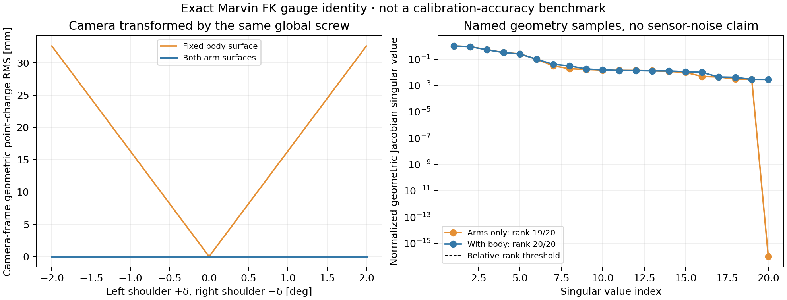
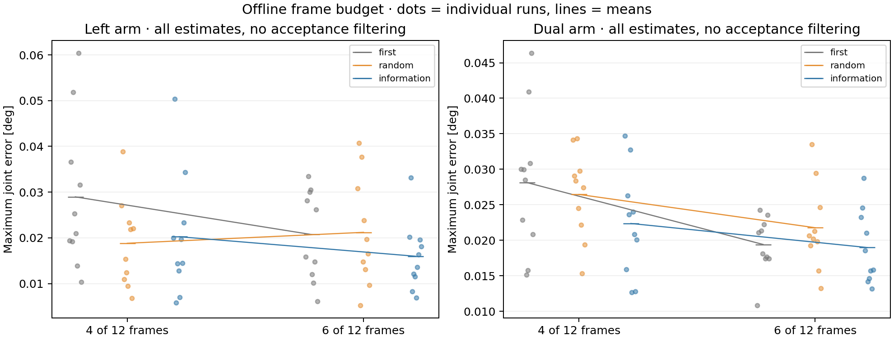
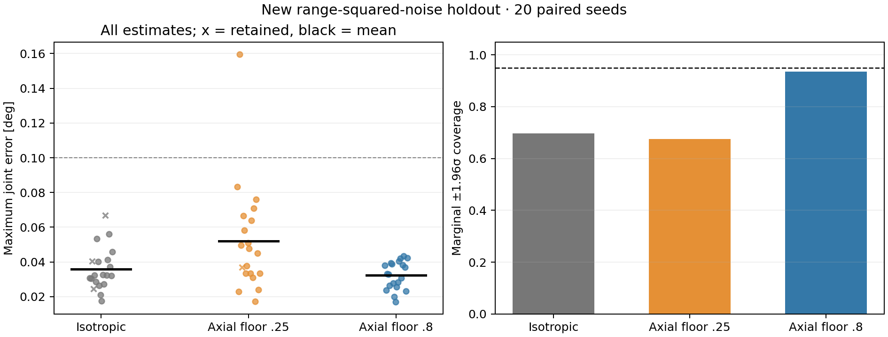
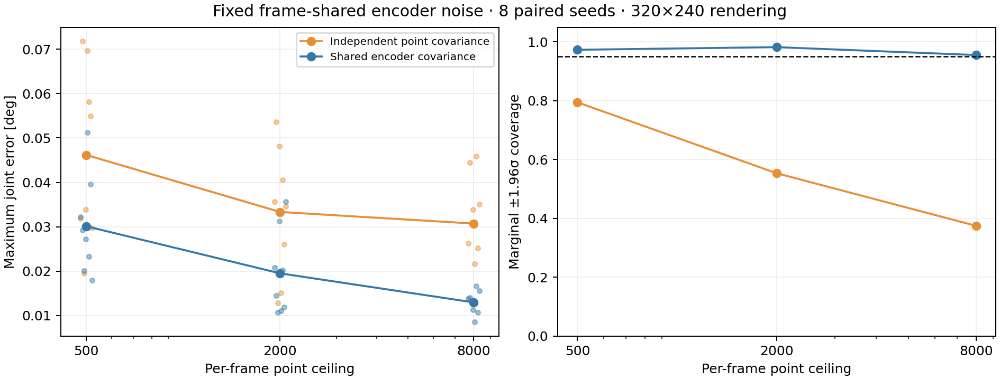

# 补充验证

这些对照与原 400 次评估分别统计；全部返回估计均纳入误差，不按接受或误差筛选。覆盖率为关节边际 ±1.96σ 的描述性统计，各关节相关，并非独立试验。它条件于关联、噪声与精确 CAD，不保证实机精度。

生成时间：2026-11-07 07:14 UTC。

## 单臂与双臂的无参考退化

当前 Marvin URDF 的两个肩部第一关节轴线共线且方向相反。10 个新种子、三个配置均不观察固定机身；左右单臂为 12/13 秩，双臂仍为 19/20，全部保留名义修正。

完成 30 条，数值源 `4e38f9a6b89ed195d8eb216fba6d8f198701f8f0231ccb12a25fa64c0d020085`。

| 条件 | 接受/返回 | 最大关节误差均值 (°) | P95 (°) | 最坏值 (°) | 边际覆盖率 |
|---|---:|---:|---:|---:|---:|
| 左臂，无固定参考 | 0/10 | — | — | — | — |
| 右臂，无固定参考 | 0/10 | — | — | — | — |
| 双臂，无固定参考 | 0/10 | — | — | — | — |

图中的点变化和雅可比来自命名几何样本的严格 FK 恒等式，展示不可区分性，不是传感器精度。带噪声、可见深度的 30 次对照另外验证上述秩与保留行为。

## 帧数预算

每个种子先生成同一批 12 帧，分别选择 4 或 6 帧。信息量策略不读取真值，不保证对所有条件都优于随机策略。

完成 120 条，数值源 `4e38f9a6b89ed195d8eb216fba6d8f198701f8f0231ccb12a25fa64c0d020085`。

| 条件 | 接受/返回 | 最大关节误差均值 (°) | P95 (°) | 最坏值 (°) | 边际覆盖率 |
|---|---:|---:|---:|---:|---:|
| 左臂，4/12，前几帧 | 10/10 | 0.02896 | 0.05659 | 0.06044 | 94.3% |
| 左臂，4/12，随机 | 10/10 | 0.01881 | 0.03355 | 0.03888 | 98.6% |
| 左臂，4/12，信息量 | 10/10 | 0.02024 | 0.04316 | 0.05035 | 95.7% |
| 左臂，6/12，前几帧 | 10/10 | 0.02072 | 0.03215 | 0.03348 | 97.1% |
| 左臂，6/12，随机 | 10/10 | 0.02120 | 0.03937 | 0.04075 | 95.7% |
| 左臂，6/12，信息量 | 10/10 | 0.01598 | 0.02733 | 0.03316 | 95.7% |
| 双臂，4/12，前几帧 | 10/10 | 0.02813 | 0.04393 | 0.04639 | 98.6% |
| 双臂，4/12，随机 | 10/10 | 0.02646 | 0.03423 | 0.03432 | 97.1% |
| 双臂，4/12，信息量 | 10/10 | 0.02237 | 0.03383 | 0.03473 | 97.9% |
| 双臂，6/12，前几帧 | 10/10 | 0.01942 | 0.02397 | 0.02429 | 100.0% |
| 双臂，6/12，随机 | 10/10 | 0.02178 | 0.03170 | 0.03352 | 98.6% |
| 双臂，6/12，信息量 | 10/10 | 0.01899 | 0.02688 | 0.02876 | 96.4% |

## 距离平方噪声的后续独立验证

13001–13020 为新种子。三组均为 50 次外迭代上限、局部步长 0.5、不启用相机邻近重试。下限 0.8 在开发种子上选定后注册。原 400 次评估保持不变。

完成 60 条，数值源 `4e38f9a6b89ed195d8eb216fba6d8f198701f8f0231ccb12a25fa64c0d020085`。

| 条件 | 接受/返回 | 最大关节误差均值 (°) | P95 (°) | 最坏值 (°) | 边际覆盖率 |
|---|---:|---:|---:|---:|---:|
| 各向同性控制 | 17/20 | 0.03585 | 0.05657 | 0.06683 | 69.6% |
| 光轴，下限 0.25 | 19/20 | 0.05208 | 0.08704 | 0.15959 | 67.5% |
| 光轴，下限 0.8 | 20/20 | 0.03243 | 0.04233 | 0.04342 | 93.6% |

原下限 0.25 的一个估计超过 0.1° 参考线；该结果没有删除。候选下限 0.8 的经验覆盖率仍未精确达到名义 95%，不能视为完整置信保证。

## 点数与共享编码器噪声

320×240 图像，实际编码器标准差均为 0.01°。每帧最多 500/2000/8000 点，不同点数共享同一帧级编码器扰动。不同帧仍假定独立。耗时包括渲染、加载、关联与拟合。

完成 48 条，数值源 `4e38f9a6b89ed195d8eb216fba6d8f198701f8f0231ccb12a25fa64c0d020085`。

| 条件 | 接受/返回 | 最大关节误差均值 (°) | P95 (°) | 最坏值 (°) | 边际覆盖率 |
|---|---:|---:|---:|---:|---:|
| 至多 500 点，不建模共享编码器误差 | 8/8 | 0.04617 | 0.07106 | 0.07183 | 79.5% |
| 至多 500 点，建模共享编码器误差 | 8/8 | 0.03010 | 0.04720 | 0.05128 | 97.3% |
| 至多 2000 点，不建模共享编码器误差 | 8/8 | 0.03332 | 0.05175 | 0.05367 | 55.4% |
| 至多 2000 点，建模共享编码器误差 | 8/8 | 0.01948 | 0.03407 | 0.03560 | 98.2% |
| 至多 8000 点，不建模共享编码器误差 | 8/8 | 0.03071 | 0.04538 | 0.04586 | 37.5% |
| 至多 8000 点，建模共享编码器误差 | 8/8 | 0.01293 | 0.01627 | 0.01667 | 95.5% |

| 条件 | 平均实际输入点/帧 | 平均总耗时 (s) |
|---|---:|---:|
| 至多 500 点，不建模共享编码器误差 | 500.0 | 27.88 |
| 至多 500 点，建模共享编码器误差 | 500.0 | 29.24 |
| 至多 2000 点，不建模共享编码器误差 | 2000.0 | 70.99 |
| 至多 2000 点，建模共享编码器误差 | 2000.0 | 63.92 |
| 至多 8000 点，不建模共享编码器误差 | 6122.2 | 177.17 |
| 至多 8000 点，建模共享编码器误差 | 6122.2 | 154.04 |

增加点数减少独立深度误差，却不能把同一帧的编码器读数变成许多独立测量。当前模型也没有包含跨帧时间漂移或所有几何失配。

## 独立右臂模块

已知相机时估计 7 个零偏；相机未知且没有固定参考时保留规范自由度，不将该组任意规范解的真值差当作精度。

完成 40 条，数值源 `4e38f9a6b89ed195d8eb216fba6d8f198701f8f0231ccb12a25fa64c0d020085`。

| 条件 | 接受/返回 | 最大关节误差均值 (°) | P95 (°) | 最坏值 (°) | 边际覆盖率 |
|---|---:|---:|---:|---:|---:|
| 相机已知 | 20/20 | 0.01739 | 0.02820 | 0.03296 | 97.9% |
| 相机未知（退化） | 0/20 | — | — | — | — |

## 记录与边界

完整计划、种子与分组指标见 [补充 JSON](results/supplementary_summary.json)，逐案例 CSV 在同目录。审计 JSON 保存在每个结果目录。大初值超时与探索性续算单例见 [第二轮日志](ROUND2_LOG.md)；它们没有替换主评估中的原记录。

[主验证](VALIDATION.md) · [全部实验入口](EXPERIMENTS.md) · [方法边界](REPRODUCTION.md)
