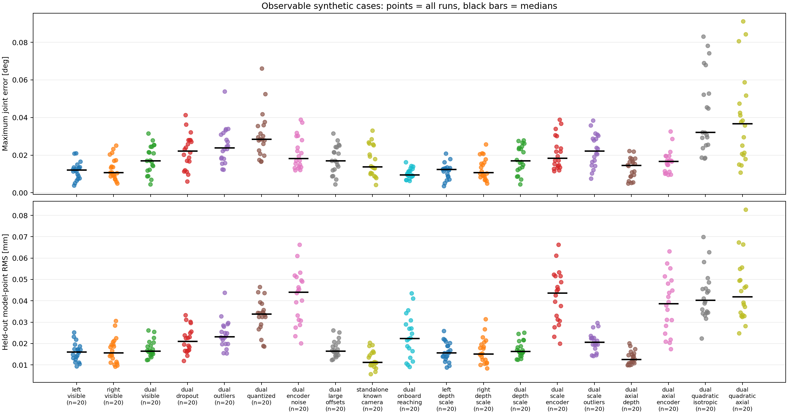
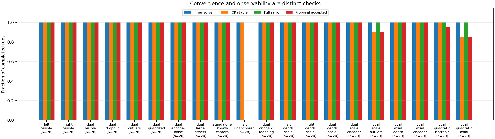

# 验证记录

数值实现 **v0.3.0**；报告生成于 2026-11-07 07:21 UTC。这是实际 Marvin URDF/网格上的合成验证，不是实机标定精度。

第二轮从 2026-11-07 05:39:48 UTC 开始；最终数值实现于 06:13:09 UTC 冻结。第一轮记录与 220 次评估保存在 [v0.2.3 历史报告](history/VALIDATION_v023.md)。

自动化测试 **80 项通过**。

## 全新种子评估

完成 **400/400** 个唯一试验：20 类场景，20 个未用于本轮调参的种子。每个进程冻结数值模块、配置与源码哈希；没有依据新种子真值改动该冻结版本。

预先声明可观测的 380 次已完成估计中，374 次通过数值接受条件；0 次最大关节误差超过 0.1° 参考线。该参考线只是合成评估指标，不是论文指标或实机接受标准。

默认每次 8 帧、160×120 针孔图像、每帧至多 2000 点；实际光轴噪声标准差 0.2 mm，零偏注入 ±0.5°。编码器噪声案例为 0.01°，尺度案例为 +0.5%，距离平方案例的光轴标准差为 0.2 mm×z²（z 的数值以米计）。精确配置以 JSON 为准。

下表包含全部已完成结果，未按恢复误差或接受结果筛选。P95 为这些种子的经验分位数。退化案例的参数不唯一，不将任意规范解与真值之差当作精度。

| 场景 | 完成 | 接受 | 最大关节误差均值 (°) | P95 (°) | 最坏值 (°) | 留出模型点 RMS 均值 (mm) |
|---|---:|---:|---:|---:|---:|---:|
| 左臂可见深度 | 20/20 | 20 | 0.01180 | 0.02087 | 0.02097 | 0.01603 |
| 右臂可见深度 | 20/20 | 20 | 0.01294 | 0.02340 | 0.02508 | 0.01675 |
| 双臂可见深度 | 20/20 | 20 | 0.01781 | 0.02807 | 0.03154 | 0.01756 |
| 双臂，30% 丢点 | 20/20 | 20 | 0.02192 | 0.03660 | 0.04135 | 0.02166 |
| 双臂，5% 离群点 | 20/20 | 20 | 0.02513 | 0.03502 | 0.05381 | 0.02442 |
| 双臂，1 mm 量化 | 20/20 | 20 | 0.03067 | 0.05316 | 0.06614 | 0.03298 |
| 双臂，共享编码器噪声 | 20/20 | 20 | 0.02129 | 0.03738 | 0.03896 | 0.04184 |
| 双臂，±2° 零偏 | 20/20 | 20 | 0.01779 | 0.02808 | 0.03161 | 0.01751 |
| 独立单臂，相机已知 | 20/20 | 20 | 0.01689 | 0.02875 | 0.03311 | 0.01247 |
| 单臂，无固定参考（退化） | 20/20 | 0 | — | — | — | — |
| 双臂，近机身视角＋伸手动作 | 20/20 | 20 | 0.01032 | 0.01437 | 0.01620 | 0.02336 |
| 左臂，0.5% 深度尺度＋联合估计 | 20/20 | 20 | 0.01152 | 0.01804 | 0.02080 | 0.01615 |
| 右臂，0.5% 深度尺度＋联合估计 | 20/20 | 20 | 0.01291 | 0.02118 | 0.02568 | 0.01658 |
| 双臂，0.5% 深度尺度＋联合估计 | 20/20 | 20 | 0.01788 | 0.02762 | 0.02794 | 0.01734 |
| 双臂，尺度＋编码器噪声 | 20/20 | 20 | 0.02117 | 0.03692 | 0.03885 | 0.04179 |
| 双臂，尺度＋离群点 | 20/20 | 18 | 0.02264 | 0.03603 | 0.03842 | 0.02085 |
| 双臂，光轴噪声权重 | 20/20 | 20 | 0.01319 | 0.02189 | 0.02220 | 0.01329 |
| 双臂，光轴权重＋编码器噪声 | 20/20 | 20 | 0.01674 | 0.02889 | 0.03258 | 0.03823 |
| 距离平方噪声，各向同性权重 | 20/20 | 19 | 0.04258 | 0.07842 | 0.08310 | 0.04255 |
| 距离平方噪声，光轴/距离权重 | 20/20 | 17 | 0.03924 | 0.08464 | 0.09115 | 0.04488 |

留出模型点在另外十组姿态上做无观测噪声的 FK 对比，检查零偏误差传播；仍使用声明的合成几何，不能代替独立实机测量。

[紧凑 JSON](results/validation_summary.json) · [逐案例 CSV](results/metrics.csv)

## 尺度与不确定度

`depth_scale` 修正原始相机点，理论参考为 1/1.005；下表为修正后相对尺度的绝对误差。CAD 的整体米制尺度与传感器尺度存在不可区分性，不能据此诊断真实传感器故障。

| 场景 | 尺度误差均值 (ppm) | 最坏值 (ppm) |
|---|---:|---:|
| 左臂，0.5% 深度尺度＋联合估计 | 4.083 | 8.992 |
| 右臂，0.5% 深度尺度＋联合估计 | 4.257 | 9.471 |
| 双臂，0.5% 深度尺度＋联合估计 | 2.845 | 8.251 |
| 双臂，尺度＋编码器噪声 | 2.893 | 7.903 |
| 双臂，尺度＋离群点 | 4.196 | 10.309 |

下表统计关节边际 ±1.96σ 区间覆盖率。各关节相关，样本不是独立伯努利试验；协方差条件于最终关联、噪声模型和固定 CAD。它不包含对应点选择、时间失配或全部系统误差。

| 场景 | 边际覆盖率 | 标准化误差 RMS |
|---|---:|---:|
| 双臂可见深度 | 100.0% | 0.170 |
| 双臂，共享编码器噪声 | 96.4% | 0.943 |
| 双臂，光轴噪声权重 | 92.9% | 1.062 |
| 双臂，光轴权重＋编码器噪声 | 93.9% | 1.065 |
| 距离平方噪声，各向同性权重 | 67.9% | 2.063 |
| 距离平方噪声，光轴/距离权重 | 77.5% | 1.890 |

## 未接受结果与局限

预期可观测场景有 6 次未通过接受条件，另有 0 次异常。退化单臂对照应给出 12/13 秩并保留名义修正。

- `dual_quadratic_axial` / seed 12003：icp_not_converged；最大关节误差 0.04744°。
- `dual_quadratic_axial` / seed 12007：icp_not_converged；最大关节误差 0.03769°。
- `dual_quadratic_axial` / seed 12009：icp_not_converged；最大关节误差 0.02074°。
- `dual_quadratic_isotropic` / seed 12012：residual_noise_inconsistent；最大关节误差 0.02523°。
- `dual_scale_outliers` / seed 12005：icp_not_converged；最大关节误差 0.01646°。
- `dual_scale_outliers` / seed 12014：icp_not_converged；最大关节误差 0.02863°。

历史失败包括固定迭代收紧距离导致丢失腕部观测、周期几何错误分支、整帧裁剪掩盖稀疏腕部、过小光轴噪声下限导致迭代不稳定。本轮保留开发与失败记录，没有并入全新种子统计，见 [第二轮日志](ROUND2_LOG.md)。

原始资产未修改。资产没有已核验的实际相机挂载；渲染只包含配置中的表面，没有环境、完整传感器或硬件执行模型。腕部阶段使用合成米制位姿；真实 VO/互视前端尚未接入。下肢和头部仍是独立玩具数值核心。

## 复查

- 冻结数值源 SHA-256：`4e38f9a6b89ed195d8eb216fba6d8f198701f8f0231ccb12a25fa64c0d020085`。
- 完整运行记录、配置与源码快照：`outputs/final_v030`。
- 复现命令：`bash scripts/reproduce.sh`；多种子计划：`configs/benchmark_final.json`。
- 每帧/连杆残差、协方差、拒绝原因保留在逐案例 JSON 中。
- [方法与论文差异](REPRODUCTION.md) · [数据接口](DATA_FORMAT.md) · [尺度对照动画](figures/scale_calibration.gif)。
