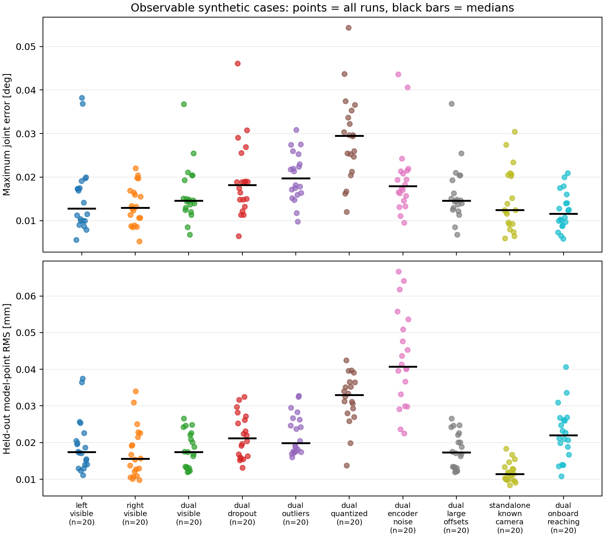
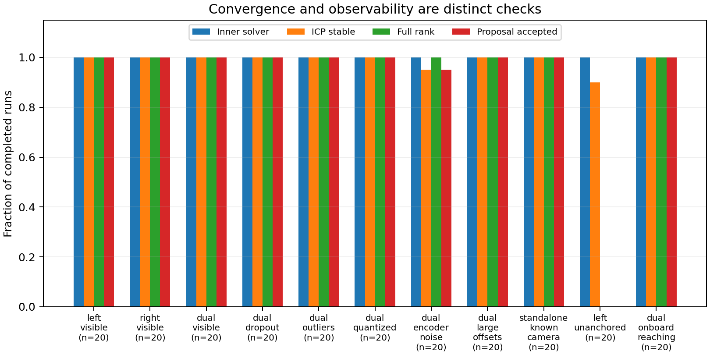
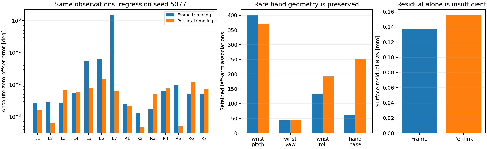

# 验证记录

本次工作跨越北京时间 2026-11-06 夜间至 2026-11-07 凌晨。数值实现为 v0.2.3；当前结果属于真实 Marvin URDF/网格上的合成验证，不是实机标定精度。

自动化测试 **56 项通过**，Ruff、Bash 语法、严格 JSON、NPZ 回放和安装后命令行入口均已检查。

## 新种子评估

已合并 **220/220** 个唯一案例。每类计划 20 个未参与当前版本调参的新种子；11 类场景。数值代码与配置均有冻结快照，URDF 和网格带 SHA-256。

默认每次 8 帧，160×120 针孔深度图，每帧至多 2000 点，轴向深度噪声标准差 0.2 mm。观察相机位于机器人前方；近机身视角使用独立 IK 伸手动作。除特别说明外，编码器无额外噪声，注入范围为 ±0.5°。

下表包含所有已完成估计，未按真值误差筛选。接受数只表示声明的数值、局部可观测性和噪声条件通过，不能代替真值恢复检查。P95 为这些种子的经验分位数，不是实机误差上界。

| 场景 | 完成 | 数值接受 | 最大关节误差均值 (°) | P95 (°) | 最坏值 (°) | 留出模型点 RMS 均值 (mm) |
|---|---:|---:|---:|---:|---:|---:|
| 左臂可见深度 | 20 | 20 | 0.01555 | 0.03693 | 0.03826 | 0.01931 |
| 右臂可见深度 | 20 | 20 | 0.01355 | 0.02049 | 0.02205 | 0.01736 |
| 双臂可见深度 | 20 | 20 | 0.01619 | 0.02602 | 0.03682 | 0.01813 |
| 双臂，30% 丢点 | 20 | 20 | 0.01931 | 0.03154 | 0.04608 | 0.02182 |
| 双臂，5% 离群点 | 20 | 20 | 0.02010 | 0.02765 | 0.03085 | 0.02229 |
| 双臂，1 mm 深度量化 | 20 | 20 | 0.02903 | 0.04424 | 0.05433 | 0.03205 |
| 双臂，0.01° 编码器噪声＋共享协方差 | 20 | 19 | 0.01981 | 0.04079 | 0.04360 | 0.04278 |
| 双臂，±2° 注入范围 | 20 | 20 | 0.01627 | 0.02601 | 0.03685 | 0.01808 |
| 独立单臂，相机已知 | 20 | 20 | 0.01485 | 0.02756 | 0.03041 | 0.01196 |
| 单臂，无固定参考（退化） | 20 | 0 | — | — | — | — |
| 双臂，近机身视角＋伸手动作 | 20 | 20 | 0.01231 | 0.02004 | 0.02090 | 0.02261 |

退化场景的参数不唯一，因此不将任意规范解与真值之差当作精度；完整 JSON 仍保留这些数值。预期秩为 12/13，并保留名义修正。

留出模型点是在另外十组姿态上做的无观测噪声 FK 对比，用于检查已估计零偏的传播；不是独立实机测量。更详细的校准前后根坐标点误差、相机点误差和相机外参误差在逐案例 JSON 中。

可复查的紧凑汇总见 [JSON](../results/validation_summary_v023.json)，逐案例指标见 [CSV](../results/metrics_v023.csv)。下图的精度部分只画预先声明可观测的场景；退化场景仍在接受判断图及完整数据中保留。

## 已发现并保留的失败记录

1. 固定按迭代次数收紧匹配距离，在新种子上造成数度局部错误。该轮试验主动停止、转为开发回归，推荐 profile 不再使用这一时间表。

2. 周期几何可形成收敛且局部满秩的错误分支。一例约 1.60° 的错误解，其归一化残差约 3.5；噪声一致性门控和邻近相机初值重试后，误差约 0.0127°。重试依据观测残差，不读取真值。

3. v0.2.2 的整帧统一裁剪，在 5% 离群点试验中曾留下约 1.50° 的腕部错误，虽然裁剪后残差很小。v0.2.3 改为逐连杆裁剪并保护稀少点组；同一回归案例降至约 0.0146°。修正前 220 次验证和修正后全新种子验证分开保存。

## 编码器相关噪声与模型失配

开发集三个种子上，独立点噪声模型的最大零偏误差均值约 0.0558°，加入帧内共享编码器误差后约 0.0255°；局部 95% 区间的描述性覆盖率由约 59.5% 变为约 97.6%。样本较小，这些数字不构成硬件置信保证。

敏感性试验显示，即使仍然满秩并收敛，0.2% 网格缩放、0.3 mm 安装位置扰动或 0.1% 深度尺度偏差，都可能使恢复误差明显上升。零偏＋外参模型不能自动补偿全部 CAD、尺度和时间失配。

## 场景与实现限制

- 资产中没有实际相机挂载；观察相机和腕部安装为假设配置。
- 渲染为首交点几何模型，只包含配置列出的 surface links，不含环境、完整光学模型或执行可行性。
- 八个开发姿态的完整网格审查中，遗漏的四个指部网格对已建模可见像素的平均遮挡约为近机身 0.039%、前方 0.075%；不能推广到任意夹爪开度。
- 腕部阶段使用合成米制相机位姿，尚无真实 VO/互视前端。下肢、头部仅为玩具数值核心。

## 复查文件

- 冻结数值源代码 SHA-256：`210f55c09a66cd0a686196d400587f9adc065aad377a497066729ffc8c79b600`。
- 合并结果：`outputs/final_v023/summary.json`、`runs/`、`source_snapshots/`。
- 默认基准计划：`configs/benchmark_final.json`。
- 历史开发与失败记录：`outputs/development_v1`、`outlier_ablation_v2`、`convergence_ablation_v3`、`sensitivity_v4`、`encoder_covariance_v5`、`heldout_v020`、`heldout_v022`。
- `robot_with_ee.urdf` SHA-256：`c1dec0dad56bf3cfbf5a193f7623ef22d513ecc354e4b0ce90f1ccf05a432972`。
- 原始资产未修改；完整方法差异见 [复现说明](../REPRODUCTION.md)，数据接口见 [数据格式](../DATA_FORMAT.md)。

200 个声明可观测案例中，199 个满足全部数值接受条件；一个共享编码器噪声案例在迭代上限内未稳定，保留名义模型。另有 20 个退化案例全部保留。

